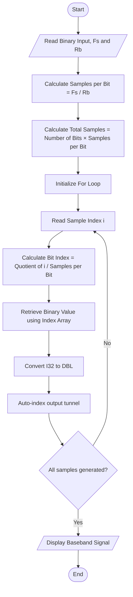
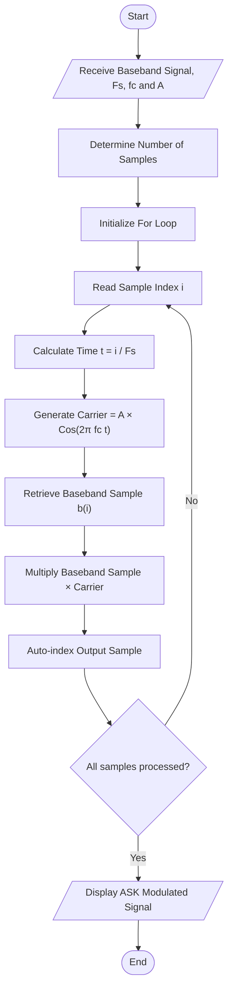
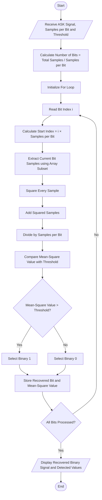
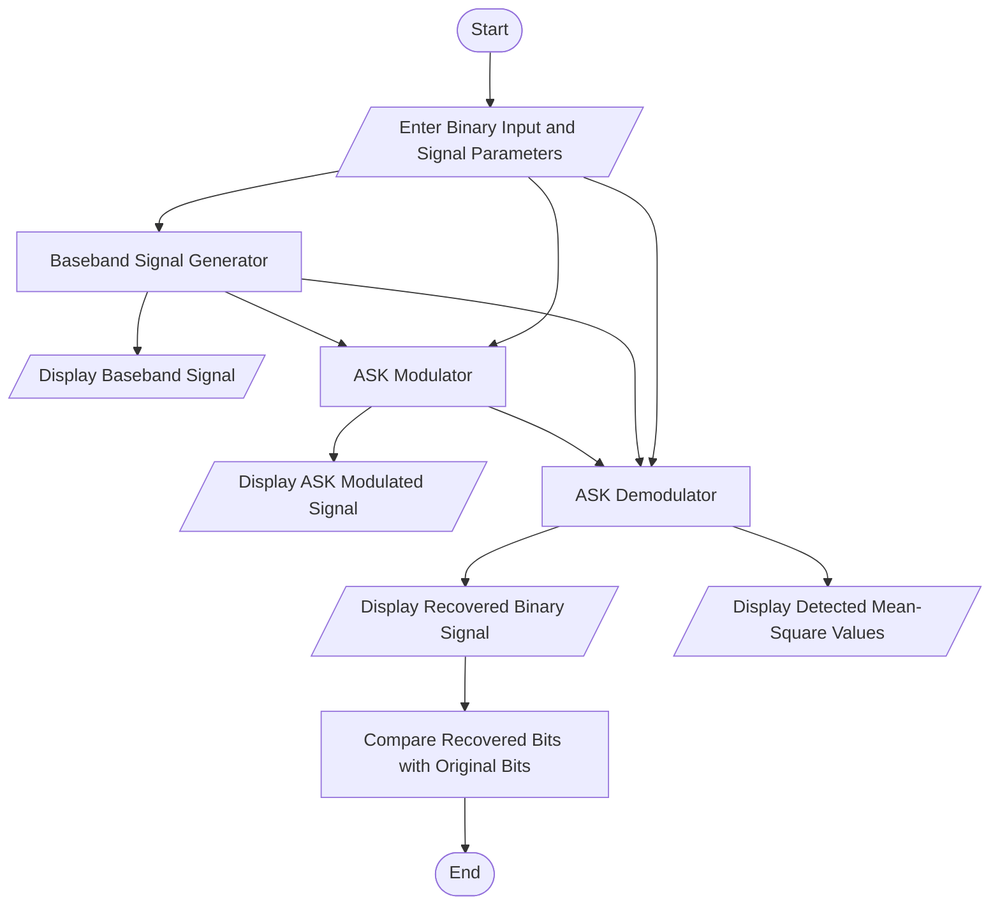

# Experiment 3 – Digital Signal Modulation

## Part 1: Baseband Signal Generation, ASK Modulation and ASK Demodulation

> Implemented in **LabVIEW** using SubVIs integrated into a Main VI.

---

## Table of Contents

1. [Aim](#1-aim)
2. [Theory](#2-theory)
3. [Experimental Parameters and Calculations](#3-experimental-parameters-and-calculations)
4. [Program 1 – Baseband Signal Generator.vi](#4-program-1--baseband-signal-generatorvi)
5. [Program 2 – ASK Modulation.vi](#5-program-2--ask-modulationvi)
6. [Program 3 – ASK Demodulator.vi](#6-program-3--ask-demodulatorvi)
7. [ASK Demodulation Calculations](#7-ask-demodulation-calculations)
8. [Main VI – Digital Modulation Main.vi](#8-main-vi--digital-modulation-mainvi)
9. [Testing and Results](#9-testing-and-results)
10. [Important Concepts Learned](#10-important-concepts-learned)
11. [Conclusion](#11-conclusion)
12. [Future Work](#12-future-work)

---

## 1. Aim

To understand and implement digital signal modulation using LabVIEW by generating a digital baseband signal, applying Amplitude Shift Keying (ASK), and recovering the original binary sequence using an ASK demodulator.

The experiment involves:

- Generating a digital baseband signal from a binary input sequence.
- Understanding sampling frequency, bit rate, sampling period and samples per bit.
- Implementing ASK modulation using a sinusoidal carrier.
- Implementing ASK demodulation using a threshold-based detection technique.
- Integrating the individual SubVIs into a Main VI.
- Verifying that the recovered binary sequence matches the transmitted sequence.

---

## 2. Theory

### 2.1 What is Digital Modulation?

Digital modulation is the process of modifying a property of a high-frequency carrier signal according to digital information (binary data).

The digital information consists of bits 0 and 1. Instead of directly transmitting the baseband digital signal, it is used to control a carrier signal.

The three modulation techniques planned for this experiment are:

1. Amplitude Shift Keying (ASK)
2. Frequency Shift Keying (FSK)
3. Phase Shift Keying (PSK)

Each technique modifies a different property of the carrier:

| Modulation technique | Carrier property modified |
|---|---|
| ASK | Amplitude |
| FSK | Frequency |
| PSK | Phase |

In this part, ASK modulation and demodulation have been implemented and tested.

### 2.2 What is a Baseband Signal?

A baseband signal is the original digital information before modulation.

For example, consider the binary sequence:

`[1, 0, 1, 1, 0, 0, 1, 0]`

Each bit is represented by a constant signal level over its bit duration.

**Unipolar Non-Return-to-Zero (NRZ)** encoding is used:

- Binary `1` is represented by `+1`.
- Binary `0` is represented by `0`.

The signal remains at the same level throughout the duration of a bit. It does not return to zero between consecutive bits containing 1.

### 2.3 Why Do We Need Sampling?

A continuous-time signal contains values at every instant of time. However, LabVIEW processes the signal as a collection of discrete numerical values.

Sampling converts the signal into discrete values at equally spaced time intervals.

The sampling frequency determines how many samples are generated per second.

A higher sampling frequency provides more samples to represent the signal, allowing its waveform to be represented more accurately.

### 2.4 Important Sampling Parameters

**Sampling Frequency ($F_s$):** The number of samples generated per second.

**Sampling Period ($T_s$):** The time interval between two consecutive samples.

$$
T_s = \frac{1}{F_s}
$$

**Bit Rate ($R_b$):** The number of bits transmitted per second.

**Bit Duration ($T_b$):** The time required to transmit one bit.

$$
T_b = \frac{1}{R_b}
$$

**Samples per Bit ($N_s$):** The number of samples used to represent one binary bit.

$$
N_s = \frac{F_s}{R_b}
$$

This value is important because the demodulator must know how many samples belong to each bit.

---

## 3. Experimental Parameters and Calculations

The following parameters were selected for the experiment.

| Parameter | Symbol | Value |
|---|---|---:|
| Binary sequence | — | `[1,0,1,1,0,0,1,0]` |
| Number of bits | N | 8 |
| Sampling frequency | Fs | 10,000 Hz |
| Bit rate | Rb | 100 bits/s |
| Carrier frequency | fc | 1,000 Hz |
| Carrier amplitude | A | 1 |
| Detection threshold | Threshold | 0.1 |

### 3.1 Sampling Period

$$
T_s = \frac{1}{F_s} = \frac{1}{10000} = 0.0001\ \text{s}
$$

$$
\boxed{T_s = 0.1\ \text{ms}}
$$

A new sample is generated every 0.1 milliseconds.

### 3.2 Bit Duration

$$
T_b = \frac{1}{R_b} = \frac{1}{100} = 0.01\ \text{s}
$$

$$
\boxed{T_b = 10\ \text{ms}}
$$

Each binary bit is represented for 10 milliseconds.

### 3.3 Samples per Bit

$$
N_s = \frac{F_s}{R_b} = \frac{10000}{100}
$$

$$
\boxed{N_s = 100}
$$

Therefore, each bit is represented using 100 samples.

### 3.4 Total Number of Samples

$$
N_{\text{total}} = N_{\text{bits}} \times N_s = 8 \times 100
$$

$$
\boxed{N_{\text{total}} = 800}
$$

Therefore, the generated baseband signal contains 800 samples.

### 3.5 Total Signal Duration

$$
T_{\text{total}} = \frac{N_{\text{bits}}}{R_b} = \frac{8}{100}
$$

$$
\boxed{T_{\text{total}} = 0.08\ \text{s}}
$$

The complete eight-bit sequence lasts 80 milliseconds.

### 3.6 Carrier Cycles per Bit

The carrier frequency is 1000 Hz, and the bit rate is 100 bits/s.

$$
\text{Carrier cycles per bit} = \frac{f_c}{R_b} = \frac{1000}{100} = 10
$$

Therefore, the carrier completes 10 cycles during each bit duration. This provides a convenient number of carrier cycles for each bit interval.

---

## 4. Program 1 – Baseband Signal Generator.vi

### 4.1 Aim

To generate a digital baseband signal from a given binary sequence using Unipolar NRZ encoding.

### 4.2 Front Panel

**Controls:**

- Binary Input – 1D I32 array.
- Sampling Frequency (Fs) – DBL.
- Bit Rate (Rb) – DBL.

**Indicators:**

- Samples per Bit – I32.
- Total Samples – I32.
- Baseband Signal – 1D DBL array.
- Baseband NRZ Signal – Waveform Graph.

### 4.3 Block Diagram Implementation

#### Step 1 – Calculate Samples per Bit

The sampling frequency is divided by the bit rate.

$$
N_s = \frac{F_s}{R_b} = \frac{10000}{100} = 100
$$

The result is converted to an integer because the number of samples per bit must be a whole number. The result is connected to the **Samples per Bit** indicator.

**Why is this required?** The generator must know how many times each binary bit should be repeated when creating the discrete baseband waveform.

#### Step 2 – Calculate Total Samples

The **Array Size** function determines the number of bits in the input array.

$$
N_{\text{total}} = \text{Array Size} \times N_s = 8 \times 100 = 800
$$

This value determines the number of iterations required by the For Loop.

#### Step 3 – Configure the For Loop

The total number of samples is connected to the **N** terminal of the For Loop. Therefore, the loop executes 800 times.

The iteration terminal `i` represents the current sample index. Its values are:

`0, 1, 2, ..., 799`

#### Step 4 – Determine the Corresponding Bit Index

The sample index is not the same as the bit index.

- Sample index 0 belongs to bit 0.
- Sample index 100 belongs to bit 1.
- Sample index 200 belongs to bit 2.

The **Quotient and Remainder** operation is used to determine the corresponding bit index.

$$
\text{Bit Index} = \left\lfloor \frac{i}{N_s} \right\rfloor
$$

For example:

$$
\frac{250}{100} = 2 \text{ remainder } 50
$$

The quotient is 2, so sample 250 belongs to bit index 2. The remainder is not needed for this implementation.

**Why use Quotient and Remainder?** The quotient gives the integer bit index without rounding. This is important because the bit index must remain within the correct array element.

#### Step 5 – Retrieve the Binary Value

The **Index Array** function retrieves the binary value corresponding to the calculated bit index.

For example, if the bit index is 2:

`Binary Input[2] = 1`

The retrieved I32 value is converted into DBL before being sent to the output array.

#### Step 6 – Generate the Baseband Array

The output tunnel of the For Loop is **auto-indexed**. Each iteration produces one sample, and LabVIEW automatically collects all 800 output values into a 1D DBL array.

The resulting array is connected to the **Baseband Signal** indicator and waveform graph.

### 4.4 Flowchart – Baseband Signal Generator

### 4.5 Expected Baseband Output

Input binary sequence: `[1, 0, 1, 1, 0, 0, 1, 0]`

Each bit is repeated for 100 samples.

| Bit index | Binary value | Sample range | Baseband level |
|---:|---:|---|---:|
| 0 | 1 | 0–99 | +1 |
| 1 | 0 | 100–199 | 0 |
| 2 | 1 | 200–299 | +1 |
| 3 | 1 | 300–399 | +1 |
| 4 | 0 | 400–499 | 0 |
| 5 | 0 | 500–599 | 0 |
| 6 | 1 | 600–699 | +1 |
| 7 | 0 | 700–799 | 0 |

The resulting waveform contains eight bit intervals, each lasting 10 milliseconds.

---

## 5. Program 2 – ASK Modulation.vi

### 5.1 Aim

To implement Amplitude Shift Keying by varying the amplitude of a sinusoidal carrier according to the digital baseband signal.

### 5.2 Theory of ASK

Amplitude Shift Keying is a digital modulation technique in which the amplitude of the carrier signal changes according to the binary input.

For this experiment, **On-Off Keying (OOK)**, a form of ASK, is used.

- Bit 1: Carrier is transmitted.
- Bit 0: Carrier is switched off.

The ASK signal is represented by:

$$
s(t) = A\, b(t) \cos(2\pi f_c t)
$$

Where:

- $A$ = Carrier amplitude
- $b(t)$ = Baseband signal
- $f_c$ = Carrier frequency
- $t$ = Time

For a discrete-time signal:

$$
s[n] = A\, b[n] \cos\left(\frac{2\pi f_c n}{F_s}\right)
$$

### 5.3 Why Do We Need a Carrier?

The baseband signal contains the original digital information. The carrier is a higher-frequency sinusoidal signal used to represent that information through modulation.

In ASK, the carrier amplitude is controlled by the baseband signal. When the bit is 1, the carrier is present. When the bit is 0, the carrier amplitude becomes zero.

### 5.4 Front Panel

**Controls:**

- Baseband Signal – 1D DBL array.
- Sampling Frequency (Fs) – DBL.
- Carrier Frequency (fc) – DBL.
- Carrier Amplitude (A) – DBL.

**Indicators:**

- ASK Modulated Signal – 1D DBL array.
- ASK Waveform Graph.

### 5.5 Block Diagram Implementation

#### Step 1 – Determine the Number of Samples

The **Array Size** function determines the number of samples in the incoming baseband signal.

$$
N = 800
$$

This value is connected to the For Loop **N** terminal.

#### Step 2 – Generate the Time Value

The For Loop iteration terminal `i` represents the sample index. The time corresponding to each sample is:

$$
t = \frac{i}{F_s}
$$

For example, at sample index 100:

$$
t = \frac{100}{10000} = 0.01\ \text{s}
$$

This corresponds to the beginning of the second bit interval.

#### Step 3 – Generate the Carrier Signal

The carrier is generated using the **Cosine** function.

$$
c(t) = A \cos(2\pi f_c t)
$$

The implementation performs the following operations:

1. Multiply carrier frequency by time.
2. Multiply the result by $2\pi$.
3. Pass the result to the Cosine function.
4. Multiply the cosine output by carrier amplitude $A$.

For the selected parameters:

$$
c(t) = 1 \times \cos(2\pi \times 1000 \times t)
$$

#### Step 4 – Retrieve the Baseband Sample

The **Index Array** function retrieves the baseband value corresponding to the current sample index.

The Baseband Signal input enters the For Loop with **indexing disabled** because the complete array must be available for Index Array to retrieve individual samples.

#### Step 5 – Perform ASK Modulation

The retrieved baseband sample is multiplied by the carrier sample.

$$
s[n] = A\, b[n] \cos\left(\frac{2\pi f_c n}{F_s}\right)
$$

If the baseband sample is 1:

$$
s[n] = 1 \times 1 \times \cos\left(\frac{2\pi f_c n}{F_s}\right)
$$

The carrier waveform is transmitted.

If the baseband sample is 0:

$$
s[n] = 1 \times 0 \times \cos\left(\frac{2\pi f_c n}{F_s}\right) = 0
$$

The output becomes zero.

#### Step 6 – Generate the ASK Output Array

The output tunnel of the For Loop is auto-indexed to collect all 800 modulated samples into a 1D DBL array. The array is connected to the **ASK Modulated Signal** output and waveform graph.

### 5.6 Flowchart – ASK Modulation

### 5.7 Expected ASK Output

For the binary sequence `[1, 0, 1, 1, 0, 0, 1, 0]`, the ASK waveform behaves as follows:

| Bit | Binary value | ASK output |
|---:|---:|---|
| 1 | 1 | Carrier present |
| 2 | 0 | Zero |
| 3 | 1 | Carrier present |
| 4 | 1 | Carrier present |
| 5 | 0 | Zero |
| 6 | 0 | Zero |
| 7 | 1 | Carrier present |
| 8 | 0 | Zero |

The carrier frequency is 1000 Hz, and its amplitude is 1. The ASK output contains 800 samples, just like the baseband signal.

---

## 6. Program 3 – ASK Demodulator.vi

### 6.1 Aim

To recover the original binary sequence from an ASK-modulated signal using mean-square detection and threshold comparison.

### 6.2 Theory of ASK Demodulation

Demodulation is the process of recovering the original digital information from a modulated signal.

Since On-Off Keying is used:

- A carrier is present when the transmitted bit is 1.
- No carrier is present when the transmitted bit is 0.

The demodulator examines the received signal over each bit interval and determines whether sufficient signal energy is present. For this experiment, **mean-square detection** is used.

### 6.3 Why Do We Need Samples per Bit?

The ASK signal contains 800 samples representing 8 bits. The demodulator needs to divide these samples into eight separate groups.

Since each bit contains 100 samples:

$$
N_s = 100
$$

The demodulator uses this value to extract the correct group of samples for each bit.

### 6.4 Front Panel

**Controls:**

- ASK Modulated Signal – 1D DBL array.
- Samples per Bit – I32.
- Threshold – DBL.

**Indicators:**

- Recovered Binary Signal – 1D I32 array.
- Detected Energy – 1D DBL array.

### 6.5 Block Diagram Implementation

#### Step 1 – Determine the Number of Bits

The **Array Size** function determines the number of samples in the ASK signal.

$$
N_{\text{bits}} = \frac{\text{Total Samples}}{N_s} = \frac{800}{100} = 8
$$

The quotient from the Quotient and Remainder function is connected to the For Loop **N** terminal. Therefore, the demodulator executes eight iterations, one for each bit.

#### Step 2 – Determine the Starting Index

The For Loop iteration terminal `i` represents the current bit index. The starting sample index for each bit is:

$$
\text{Start Index} = i \times N_s
$$

- Bit 0: Start index = 0 × 100 = 0
- Bit 1: Start index = 1 × 100 = 100
- Bit 2: Start index = 2 × 100 = 200

#### Step 3 – Extract the Samples for the Current Bit

The **Array Subset** function extracts the samples belonging to the current bit.

Its inputs are:

- Array: ASK Modulated Signal
- Index: Starting Index
- Length: Samples per Bit

For example, when `i = 2`:

$$
\text{Start Index} = 2 \times 100 = 200
$$

Array Subset extracts samples from index 200 to 299. This gives 100 samples corresponding to the third bit.

#### Step 4 – Square the Samples

Each extracted sample is squared using the **Square** function.

$$
s^2[n]
$$

Squaring removes negative signs and makes the values positive. It also provides a measure of the signal's power.

#### Step 5 – Calculate Mean-Square Value

The **Add Array Elements** function adds all squared samples. The result is divided by the number of samples per bit.

$$
E_i = \frac{1}{N_s} \sum_{n=0}^{N_s-1} s_i^2[n]
$$

This is the mean-square value of the received signal over the current bit interval. It is used as an energy-related detection measure. Strictly speaking, it is an average squared amplitude rather than total physical energy.

#### Step 6 – Compare with the Threshold

The calculated mean-square value is compared with the threshold.

$$
E_i > \text{Threshold}
$$

- If the comparison is **TRUE**: a binary 1 is detected.
- If the comparison is **FALSE**: a binary 0 is detected.

The **Select** function is used to select between I32 values 1 and 0 based on the comparison result. For this experiment, the threshold is set to **0.1**.

#### Step 7 – Generate the Recovered Binary Array

The recovered bit and its corresponding mean-square value are connected to two auto-indexed output tunnels.

After all eight iterations, the resulting arrays contain:

- Eight recovered binary values.
- Eight detected mean-square values.

### 6.6 Flowchart – ASK Demodulation

---

## 7. ASK Demodulation Calculations

### 7.1 Expected Mean-Square Value for Bit 1

For bit 1, the ASK signal contains a sinusoidal carrier:

$$
s[n] = A \cos\left(\frac{2\pi f_c n}{F_s}\right)
$$

The mean-square value is:

$$
E = \frac{1}{N_s} \sum_{n=0}^{N_s-1} s^2[n]
$$

Substituting the selected values:

$$
A = 1, \quad f_c = 1000, \quad F_s = 10000, \quad N_s = 100
$$

The signal contains 10 complete carrier cycles during each bit interval. The average value of cosine squared over complete cycles is:

$$
\operatorname{Average}(\cos^2) = \frac{1}{2}
$$

Therefore:

$$
E = A^2 \times \frac{1}{2} = 1^2 \times \frac{1}{2}
$$

$$
\boxed{E = 0.5}
$$

### 7.2 Expected Mean-Square Value for Bit 0

For bit 0, the ASK carrier is switched off:

$$
s[n] = 0
$$

Therefore:

$$
E = \frac{1}{100} \sum_{n=0}^{99} 0^2
$$

$$
\boxed{E = 0}
$$

### 7.3 Selection of Detection Threshold

The threshold must distinguish between the mean-square values of bit 1 and bit 0.

Expected values:

- Bit 1: 0.5
- Bit 0: 0

The selected threshold is:

$$
\boxed{\text{Threshold} = 0.1}
$$

The decision rule becomes:

$$
\text{Recovered Bit} =
\begin{cases}
1 & E > 0.1 \\
0 & E \leq 0.1
\end{cases}
$$

Since 0.5 is greater than 0.1 and 0 is less than 0.1, the threshold correctly identifies both bit conditions in the ideal, noiseless test.

---

## 8. Main VI – Digital Modulation Main.vi

### 8.1 Aim

To integrate the Baseband Signal Generator, ASK Modulator and ASK Demodulator SubVIs into one complete system.

### 8.2 Main VI Architecture

The Main VI acts as the top-level program. Instead of repeating the implementation of each individual operation, the previously developed SubVIs are placed and interconnected.

**Inputs:**

- Binary Input
- Sampling Frequency (Fs)
- Bit Rate (Rb)
- Carrier Frequency (fc)
- Carrier Amplitude (A)
- Detection Threshold

**Indicators:**

- Baseband Signal Waveform Graph
- ASK Modulated Signal Waveform Graph
- Recovered Binary Signal
- Detected Energy

### 8.3 Signal Flow

1. The Binary Input, Fs and Rb controls are connected to the Baseband Signal Generator.
2. The Baseband Signal Generator produces the baseband array and Samples per Bit.
3. The baseband array is displayed on the Baseband Signal Waveform Graph.
4. The baseband array, Fs, fc and A are connected to the ASK Modulator.
5. The ASK Modulator generates the ASK-modulated signal.
6. The ASK output is displayed on the ASK Waveform Graph.
7. The same ASK output is passed to the ASK Demodulator.
8. Samples per Bit and the Detection Threshold are also supplied to the demodulator.
9. The demodulator generates the recovered binary sequence and detected mean-square values.
10. Both outputs are displayed on the Main VI Front Panel.

### 8.4 Main VI Flowchart

---

## 9. Testing and Results

### 9.1 Test Case 1 – Initial Binary Sequence

**Input:** `[1, 0, 1, 1, 0, 0, 1, 0]`

**Parameters:**

| Parameter | Value |
|---|---:|
| Fs | 10,000 Hz |
| Rb | 100 bps |
| fc | 1,000 Hz |
| A | 1 |
| Threshold | 0.1 |
| Samples per Bit | 100 |
| Total Samples | 800 |

**Expected detected mean-square values:** `[0.5, 0, 0.5, 0.5, 0, 0, 0.5, 0]`

**Expected recovered binary sequence:** `[1, 0, 1, 1, 0, 0, 1, 0]`

**Result:** The recovered binary sequence matched the original input sequence.

### 9.2 Test Case 2 – Different Binary Sequence

**Input:** `[1, 1, 0, 1, 0, 1, 0, 0]`

All other parameters were kept unchanged.

**Expected recovered binary sequence:** `[1, 1, 0, 1, 0, 1, 0, 0]`

**Result:** The recovered sequence matched the new input sequence. This confirms that the ASK modulation and demodulation system is not limited to the initial binary pattern.

### 9.3 Overall Results

| Test | Expected result | Observation |
|---|---|---|
| Baseband generation | 800 samples | ✅ Successful |
| Samples per Bit | 100 | ✅ Successful |
| Total Samples | 800 | ✅ Successful |
| ASK modulation | Carrier for 1, zero for 0 | ✅ Successful |
| ASK demodulation | Correct bit detection | ✅ Successful |
| Initial sequence recovery | Exact match | ✅ Successful |
| Second sequence recovery | Exact match | ✅ Successful |

---

## 10. Important Concepts Learned

### 10.1 Difference Between Sample Index and Bit Index

A sample index identifies an individual value in the signal array. A bit index identifies the original binary bit represented by a group of samples.

Since each bit contains 100 samples:

$$
\text{Bit Index} = \left\lfloor \frac{\text{Sample Index}}{100} \right\rfloor
$$

For example, sample indices 200 to 299 all belong to bit index 2.

### 10.2 Why Are There 800 Samples but Only 8 Bits?

Each bit is represented using 100 samples.

$$
8 \times 100 = 800
$$

The signal contains 800 numerical values, but the original information contains only eight bits.

### 10.3 Why Is Auto-Indexing Used?

Auto-indexing automatically collects one output value from each For Loop iteration into an array.

- In the Baseband Generator and ASK Modulator, each iteration generates one sample.
- In the ASK Demodulator, each iteration generates one recovered bit and one detected mean-square value.

### 10.4 Why Is Indexing Disabled on Array Inputs?

When the complete array is required inside a loop, indexing must be disabled on its input tunnel. This allows functions such as Index Array and Array Subset to access the entire array using calculated indices.

### 10.5 Why Are SubVIs Used?

SubVIs divide a large application into smaller, reusable modules. Each VI performs one clearly defined operation:

- **Baseband Signal Generator:** generates the original digital signal.
- **ASK Modulation:** generates the modulated carrier.
- **ASK Demodulation:** recovers the binary information.

The Main VI connects these modules without duplicating their internal logic.

### 10.6 Why Are the ASK Modulator and Demodulator Separate?

The modulator converts binary information into a carrier-based signal. The demodulator receives that signal and attempts to recover the original binary information. Keeping them separate makes the implementation easier to test, understand, reuse and extend.

---

## 11. Conclusion

The Baseband Signal Generator, ASK Modulator and ASK Demodulator were successfully implemented in LabVIEW as separate SubVIs and integrated into the Digital Modulation Main VI.

- The baseband generator converted an eight-bit binary sequence into an 800-sample Unipolar NRZ signal using 100 samples per bit.
- The ASK modulator used a 1000 Hz sinusoidal carrier with an amplitude of 1. The carrier was transmitted for binary 1 and switched off for binary 0.
- The ASK demodulator calculated the mean-square value of each bit interval and used a threshold of 0.1 to recover the transmitted bits.
- Two different binary sequences were tested, and in both cases the recovered sequence matched the original input.

Therefore, the ideal ASK modulation and demodulation system was successfully verified.

---

## 12. Future Work

The next stages of the experiment will include:

1. Implementing Frequency Shift Keying (FSK) modulation and demodulation.
2. Implementing Phase Shift Keying (PSK) modulation and demodulation.
3. Integrating all three modulation techniques into the Main VI.
4. Introducing a simulated communication channel.
5. Adding Additive White Gaussian Noise (AWGN) to simulate transmission disturbances.
6. Studying the effect of noise on the recovered binary sequence.
7. Calculating Bit Error Rate (BER) to evaluate system performance.

The BER will be calculated using:

$$
\text{BER} = \frac{\text{Number of Incorrectly Recovered Bits}}{\text{Total Number of Transmitted Bits}}
$$

This will allow the performance of ASK, FSK and PSK to be compared under different noise conditions.
