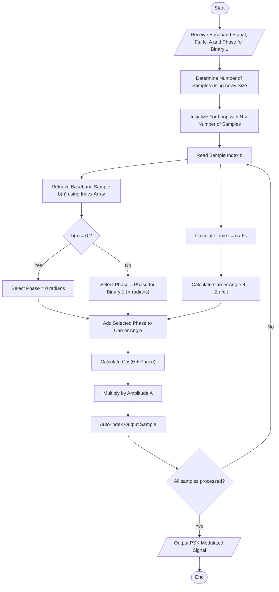
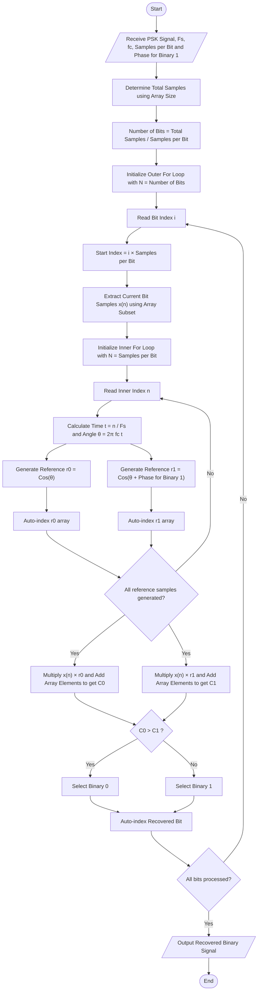
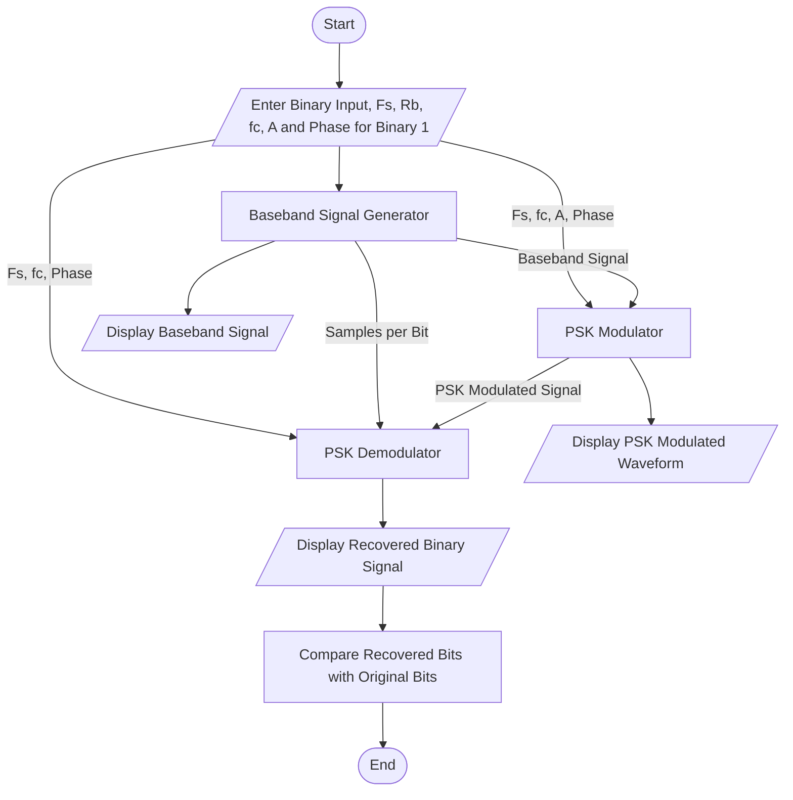

# Experiment 3 – Phase Shift Keying (PSK) Modulation and Demodulation

> Implemented in **LabVIEW** using modular SubVIs integrated into a Main VI. The Baseband Signal Generator from the ASK and FSK parts is reused.

---

## Table of Contents

1. [Aim](#1-aim)
2. [Software Requirements](#2-software-requirements)
3. [Theory](#3-theory)
4. [System Parameters](#4-system-parameters)
5. [Front Panel Implementation](#5-front-panel-implementation)
6. [Block Diagram Implementation](#6-block-diagram-implementation)
7. [Testing and Results](#7-testing-and-results)
8. [Learning Outcomes](#8-learning-outcomes)
9. [Conclusion](#9-conclusion)
10. [GitHub Folder Organization](#10-github-folder-organization)

---

## 1. Aim

To design and implement a Binary Phase Shift Keying (BPSK) modulation and demodulation system using LabVIEW.

The experiment aims to:

- Generate a digital baseband signal from a binary input sequence.
- Modulate the binary signal using a carrier whose phase changes according to the input bit.
- Demodulate the received BPSK signal using coherent correlation detection.
- Recover the original binary sequence and compare it with the transmitted input.

---

## 2. Software Requirements

- LabVIEW
- LabVIEW Project: `SELF EXERCISE 1.lvproj`

---

## 3. Theory

### 3.1 Phase Shift Keying (PSK)

Phase Shift Keying is a digital modulation technique in which the **phase** of a carrier signal is varied according to the digital input data.

In Binary Phase Shift Keying (BPSK), two different carrier phases represent the two binary states:

| Binary input | Carrier phase |
|:---:|:---:|
| 0 | 0° (0 radians) |
| 1 | 180° ($\pi$ radians) |

The carrier amplitude and frequency remain constant. Only the phase changes according to the input bit.

### 3.2 BPSK Modulation Formula

The general BPSK modulated signal is:

$$
s[n] = A \cos\left(2\pi f_c \frac{n}{F_s} + \phi\right)
$$

Where:

- $A$ = Carrier amplitude
- $f_c$ = Carrier frequency
- $F_s$ = Sampling frequency
- $n$ = Sample index
- $\phi$ = Phase selected according to the binary input

The phase selection is:

$$
\phi =
\begin{cases}
0, & \text{if input bit} = 0 \\
\pi, & \text{if input bit} = 1
\end{cases}
$$

Therefore:

$$
s[n] =
\begin{cases}
A \cos\left(2\pi f_c n / F_s\right), & \text{bit} = 0 \\
A \cos\left(2\pi f_c n / F_s + \pi\right), & \text{bit} = 1
\end{cases}
$$

Using the trigonometric identity:

$$
\cos(\theta + \pi) = -\cos(\theta)
$$

The signal for binary 1 is the **inverted** version of the carrier used for binary 0.

### 3.3 BPSK Demodulation

Coherent correlation detection is used to recover the transmitted bits.

Two locally generated reference signals are created:

**Reference for binary 0:**

$$
r_0[n] = \cos\left(2\pi f_c n / F_s\right)
$$

**Reference for binary 1:**

$$
r_1[n] = \cos\left(2\pi f_c n / F_s + \pi\right)
$$

The received signal is divided into individual bit intervals. Each interval contains a fixed number of samples.

The received samples are multiplied element by element with both reference signals. The resulting products are added to calculate two correlation values.

$$
C_0 = \sum_{n=0}^{N-1} x[n]\, r_0[n]
$$

$$
C_1 = \sum_{n=0}^{N-1} x[n]\, r_1[n]
$$

Where:

- $x[n]$ = Received signal samples for one bit
- $r_0[n]$ = Reference signal for binary 0
- $r_1[n]$ = Reference signal for binary 1
- $N$ = Number of samples per bit

The decision rule is:

$$
\text{Detected Bit} =
\begin{cases}
0, & C_0 > C_1 \\
1, & C_1 \geq C_0
\end{cases}
$$

The reference producing the higher correlation value determines the detected bit.

---

## 4. System Parameters

The following parameters were used for the experiment.

| Parameter | Value |
|---|---:|
| Binary Input | `[1,0,1,1,0,0,1,0]` |
| Sampling Frequency (Fs) | 10,000 Hz |
| Bit Rate (Rb) | 100 bps |
| Carrier Frequency (fc) | 1,000 Hz |
| Carrier Amplitude (A) | 1 |
| Phase for Binary 1 | 3.14159 radians |
| Number of Bits | 8 |
| Samples per Bit | 100 |
| Total Number of Samples | 800 |

### 4.1 Calculations

**Bit Duration:**

$$
T_b = \frac{1}{R_b} = \frac{1}{100} = 0.01\ \text{s}
$$

**Samples per Bit:**

$$
N = \frac{F_s}{R_b} = \frac{10000}{100} = 100
$$

**Total Samples:**

$$
N_{\text{total}} = 8 \times 100 = 800
$$

**Carrier Cycles per Bit:**

$$
\text{Cycles per Bit} = f_c \times T_b = 1000 \times 0.01 = 10
$$

Thus, each bit interval contains 100 samples and 10 carrier cycles.

---

## 5. Front Panel Implementation

The complete PSK system was divided into three VIs:

1. `Baseband Signal Generator.vi`
2. `PSK Modulator.vi`
3. `PSK Demodulator.vi`

These are integrated by `PSK Main.vi`.

### 5.1 PSK Modulator.vi

**Controls:**

- Baseband Signal – 1D DBL array
- Sampling Frequency (Fs)
- Carrier Frequency (fc)
- Amplitude (A)
- Phase for Binary 1

**Indicators:**

- PSK Modulated Signal – 1D DBL array
- PSK Modulated Waveform – Waveform Graph

The Front Panel provides the required modulation parameters and displays the generated PSK signal.

### 5.2 PSK Demodulator.vi

**Controls:**

- PSK Modulated Signal – 1D DBL array
- Sampling Frequency (Fs)
- Carrier Frequency (fc)
- Samples per Bit
- Phase for Binary 1

**Indicator:**

- Recovered Binary Signal – 1D I32 array

The Front Panel accepts the modulated signal and synchronization parameters and displays the recovered binary sequence.

### 5.3 PSK Main.vi

**Controls:**

- Binary Input
- Sampling Frequency (Fs)
- Bit Rate (Rb)
- Carrier Frequency (fc)
- Amplitude (A)
- Phase for Binary 1

**Indicators:**

- Baseband Signal – Waveform Graph
- PSK Modulated Signal – Waveform Graph
- Recovered Binary Signal – 1D I32 array

The Main VI integrates the baseband generator, modulator and demodulator SubVIs.

---

## 6. Block Diagram Implementation

### 6.1 Baseband Signal Generator.vi

The shared Baseband Signal Generator SubVI developed for ASK and FSK was reused for PSK.

**Implementation:**

- The binary input array is passed to the generator.
- The sampling frequency and bit rate are used to calculate the samples per bit.
- Each binary bit is expanded into the corresponding number of samples.
- Binary 1 is represented by a value of 1.0.
- Binary 0 is represented by a value of 0.0.
- The generated baseband signal and samples-per-bit value are provided as outputs.

The generator is reused rather than creating another copy for PSK.

### 6.2 PSK Modulator.vi

The modulator generates the BPSK signal using the baseband input and carrier parameters.

**Implementation:**

1. The **Array Size** function determines the total number of baseband samples.
2. A For Loop iterates through all samples.
3. The **Index Array** function retrieves the current baseband sample using the loop iteration index.
4. The **Equal To 0?** function checks whether the current sample represents binary 0.
5. A **Select** function selects the appropriate phase:
   - TRUE → 0 radians.
   - FALSE → Phase for Binary 1 ($\pi$ radians).
6. The current sample index is divided by the sampling frequency to calculate the sample time:

$$
t = \frac{n}{F_s}
$$

7. The carrier angle is calculated:

$$
\theta = 2\pi f_c t
$$

8. The selected phase is added to the carrier angle.
9. The **Cosine** function calculates the carrier waveform.
10. The output is multiplied by the carrier amplitude.
11. Auto-indexing collects all generated samples into the final PSK modulated signal array.

The resulting signal is displayed on the waveform graph.

#### Flowchart – PSK Modulator



### 6.3 PSK Demodulator.vi

The demodulator uses coherent correlation to detect the transmitted binary data.

**Implementation:**

1. The **Array Size** function determines the total number of received samples.
2. The number of bits is calculated by dividing the total samples by the samples per bit.
3. An outer For Loop iterates once for each bit.
4. The starting index of each bit interval is calculated:

$$
\text{Start Index} = i \times N
$$

Where $i$ is the outer loop iteration and $N$ is the samples per bit.

5. The **Array Subset** function extracts the received samples belonging to the current bit.
6. An inner For Loop generates the two reference signals for the current bit interval.
7. The inner loop calculates the sample time and carrier angle for each sample.
8. The first **Cosine** function generates the reference for binary 0:

$$
r_0[n] = \cos\left(2\pi f_c n / F_s\right)
$$

9. The second **Cosine** function generates the reference for binary 1 by adding the phase offset:

$$
r_1[n] = \cos\left(2\pi f_c n / F_s + \pi\right)
$$

10. Auto-indexing collects the reference samples into two arrays.
11. The received samples are multiplied element by element with the first reference array.
12. **Add Array Elements** calculates the first correlation value, $C_0$.
13. The same process is performed with the second reference array to calculate $C_1$.
14. A **Greater?** function compares $C_0$ and $C_1$.
15. A **Select** function determines the recovered bit:
    - TRUE → 0.
    - FALSE → 1.
16. The outer For Loop auto-indexes the detected bits to generate the recovered binary array.

#### Flowchart – PSK Demodulator



### 6.4 PSK Main.vi

The Main VI connects all three SubVIs.

**Implementation:**

- Binary Input and Bit Rate are connected to the Baseband Signal Generator.
- Sampling Frequency is connected to the Baseband Signal Generator, PSK Modulator and PSK Demodulator.
- The generated baseband signal is connected to the PSK Modulator.
- Carrier Frequency and Amplitude are supplied to the modulator.
- Phase for Binary 1 is connected to both the modulator and demodulator.
- The modulated signal is connected to the demodulator.
- Samples per Bit from the Baseband Signal Generator are supplied to the demodulator.
- The PSK modulated waveform and recovered binary sequence are displayed on the Main VI Front Panel.

#### Flowchart – PSK Main VI



---

## 7. Testing and Results

### 7.1 Initial Test

The system was run using the binary input:

`[1,0,1,1,0,0,1,0]`

The initial run demonstrated:

- Successful generation of the baseband signal.
- Successful generation of the PSK modulated waveform.
- Recovery of the binary input using the demodulator.

### 7.2 Carrier Frequency Verification

The carrier frequency was initially tested at 100 Hz. The frequency was subsequently changed to the intended value of 1000 Hz.

At 1000 Hz:

- The carrier completes 10 cycles per bit.
- The modulated waveform appears denser because of the higher carrier frequency.
- The phase changes between binary states are less visually obvious at the full 800-sample display scale.

Visual inspection should focus on the phase relationship between consecutive bit intervals rather than expecting the waveform to become zero for binary 0 or binary 1.

**Final verification at 1000 Hz:** The waveform's visual validation and the recovered output should be checked after the final run.

### 7.3 Expected Result

The recovered binary sequence should match the transmitted input:

| Transmitted Input | Expected Recovered Output |
|---|---|
| `[1,0,1,1,0,0,1,0]` | `[1,0,1,1,0,0,1,0]` |

Additional test sequences can be used to verify that the system is not restricted to a single binary input pattern.

---

## 8. Learning Outcomes

Through this experiment, the following concepts were learned:

- Understanding the working principle of Binary Phase Shift Keying.
- Generating a carrier signal with two different phase states.
- Understanding the relationship between phase and binary data.
- Implementing BPSK modulation using mathematical functions in LabVIEW.
- Generating local reference signals for coherent demodulation.
- Understanding correlation-based detection.
- Using Array Subset to process individual bit intervals.
- Performing element-wise array multiplication and summation.
- Using nested For Loops for sample-level and bit-level processing.
- Reusing a common Baseband Signal Generator SubVI across multiple modulation techniques.
- Integrating modular SubVIs into a Main VI.

---

## 9. Conclusion

Binary Phase Shift Keying modulation and demodulation were implemented in LabVIEW using separate SubVIs for modulation and demodulation.

The modulator changes the carrier phase according to the binary input, while the demodulator uses coherent correlation with two locally generated reference signals to recover the transmitted bits.

The three SubVIs were integrated into a Main VI, allowing the user to provide binary data and modulation parameters and observe the baseband signal, modulated waveform and recovered binary sequence.

---

## 10. GitHub Folder Organization

Recommended folder structure:

```text
Digital Modulation Techniques/
│
├── ASK/
│   ├── Main VI/
│   ├── Sub VI/
│   └── Screenshots/
│
├── FSK/
│   ├── Main VI/
│   ├── Sub VI/
│   └── Screenshots/
│
└── PSK/
    ├── Main VI/
    ├── Sub VI/
    ├── Screenshots/
    │   ├── PSK Modulator/
    │   ├── PSK Demodulator/
    │   └── PSK Main/
    │
    └── Experiment 3 - PSK Modulation.md
```

### Screenshots to Include

**PSK Modulator:**

- Front Panel showing controls and waveform graph.
- Block Diagram showing phase selection and carrier generation.

**PSK Demodulator:**

- Front Panel showing input parameters and recovered binary array.
- Block Diagram showing reference generation, correlation calculations and bit decision logic.

**PSK Main:**

- Front Panel showing binary input, baseband waveform, PSK waveform and recovered output.
- Block Diagram showing connections between all three SubVIs.
- Final successful test showing the transmitted and recovered binary sequences matching.

---

**Experiment Status:** Implementation completed; final 1000 Hz waveform and output verification pending.
