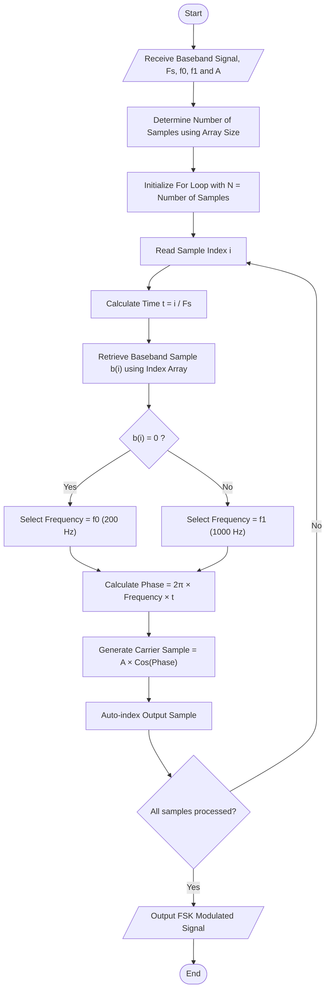
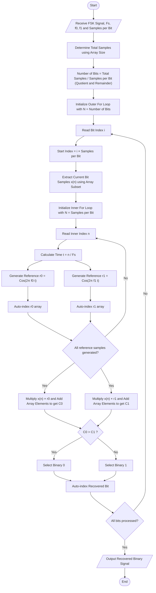
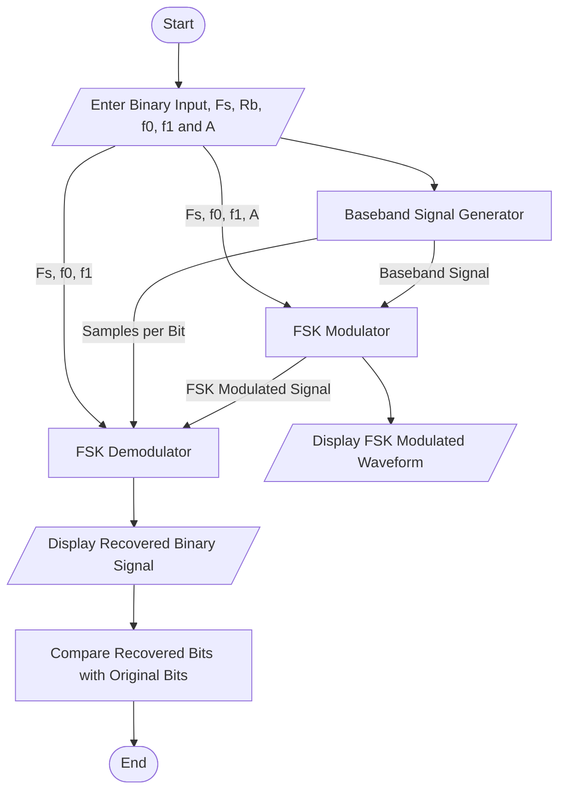
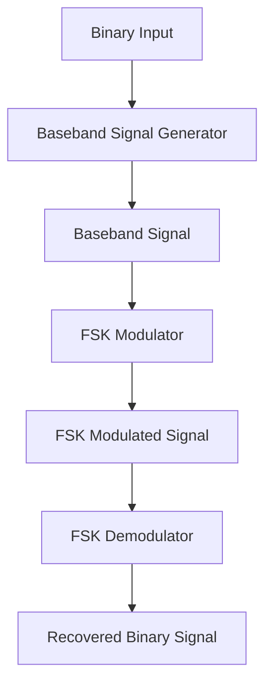

# Experiment 3 – Digital Signal Modulation

## Part 2: Frequency Shift Keying (FSK) Modulation and Demodulation

> Implemented in **LabVIEW** using modular SubVIs integrated into a Main VI. The Baseband Signal Generator from Part 1 (ASK) is reused.

---

## Table of Contents

1. [Aim](#1-aim)
2. [Theory](#2-theory)
3. [Mathematical Equations](#3-mathematical-equations)
4. [Parameters Used](#4-parameters-used)
5. [LabVIEW Implementation](#5-labview-implementation)
6. [System Flow](#6-system-flow)
7. [Important Concepts Learned](#7-important-concepts-learned)
8. [Test and Results](#8-test-and-results)
9. [Conclusion](#9-conclusion)

---

## 1. Aim

To implement Binary Frequency Shift Keying (BFSK) modulation and correlation-based demodulation in LabVIEW, and to verify that the recovered binary sequence matches the transmitted sequence.

---

## 2. Theory

### 2.1 Modulation Techniques

The digital modulation techniques considered in this experiment are:

1. Amplitude Shift Keying (ASK)
2. Frequency Shift Keying (FSK)
3. Phase Shift Keying (PSK)

### 2.2 What is Frequency Shift Keying?

Frequency Shift Keying (FSK) is a digital modulation technique in which the **frequency** of the carrier signal changes according to the binary input.

In Binary Frequency Shift Keying (BFSK):

- Binary `0` is represented by the **lower** frequency.
- Binary `1` is represented by the **higher** frequency.

The amplitude remains constant, while the frequency changes depending on the input bit.

For this experiment:

| Binary Input | Selected Frequency |
|:---:|:---:|
| 0 | 200 Hz |
| 1 | 1000 Hz |

Therefore, the receiver identifies the transmitted bit by determining which of the two frequencies is present.

---

## 3. Mathematical Equations

### 3.1 Sampling Frequency and Samples per Bit

The number of samples representing one binary bit is:

$$
N = \frac{F_s}{R_b}
$$

Where:

- $N$ = Samples per bit
- $F_s$ = Sampling frequency
- $R_b$ = Bit rate

For this experiment:

$$
N = \frac{10000}{100} = 100
$$

Therefore, each bit is represented by 100 samples.

### 3.2 Time Calculation

The time corresponding to each sample is:

$$
t[n] = \frac{n}{F_s}
$$

Where $n$ is the sample index.

### 3.3 FSK Modulation Equation

The FSK modulated signal is represented by:

$$
s[n] = A \cos\left(2\pi f_b \frac{n}{F_s}\right)
$$

Where:

- $A$ = Carrier amplitude
- $f_b$ = Frequency selected according to the input bit
- $F_s$ = Sampling frequency

The selected frequency is:

$$
f_b =
\begin{cases}
f_0, & b[n] = 0 \\
f_1, & b[n] = 1
\end{cases}
$$

For this experiment:

$$
f_0 = 200\ \text{Hz}, \qquad f_1 = 1000\ \text{Hz}
$$

Thus:

For binary 0:

$$
s[n] = A \cos\left(2\pi (200) \frac{n}{10000}\right)
$$

For binary 1:

$$
s[n] = A \cos\left(2\pi (1000) \frac{n}{10000}\right)
$$

### 3.4 FSK Demodulation Using Correlation

The receiver uses **correlation** to determine which frequency is present in each received bit interval. Correlation measures the similarity between two signals.

For every received bit, the receiver generates two reference signals:

$$
r_0[n] = \cos\left(2\pi f_0 \frac{n}{F_s}\right)
$$

$$
r_1[n] = \cos\left(2\pi f_1 \frac{n}{F_s}\right)
$$

The received samples are multiplied with the corresponding reference samples and summed.

Correlation with the lower-frequency reference:

$$
C_0 = \sum_{n=0}^{N-1} x[n]\, r_0[n]
$$

Correlation with the higher-frequency reference:

$$
C_1 = \sum_{n=0}^{N-1} x[n]\, r_1[n]
$$

Where:

- $x[n]$ = Received FSK samples for the current bit
- $r_0[n]$ = 200 Hz reference signal
- $r_1[n]$ = 1000 Hz reference signal
- $C_0$ = Lower-frequency correlation
- $C_1$ = Higher-frequency correlation

The decision rule implemented is:

$$
b =
\begin{cases}
0, & C_0 > C_1 \\
1, & C_1 \geq C_0
\end{cases}
$$

The reference producing the larger correlation determines the recovered binary bit.

---

## 4. Parameters Used

| Parameter | Value |
|---|---:|
| Binary Input | `[1,0,1,1,0,0,1,0]` |
| Sampling Frequency ($F_s$) | 10000 Hz |
| Bit Rate ($R_b$) | 100 bps |
| Lower Frequency ($f_0$) | 200 Hz |
| Higher Frequency ($f_1$) | 1000 Hz |
| Amplitude ($A$) | 1 |
| Samples per Bit | 100 |
| Number of Bits | 8 |
| Total Samples | 800 |

### 4.1 Bit Duration

$$
T_b = \frac{1}{R_b} = \frac{1}{100} = 0.01\ \text{s}
$$

### 4.2 Number of Samples

$$
\text{Total Samples} = 8 \times 100 = 800
$$

### 4.3 Number of Carrier Cycles per Bit

For the lower frequency:

$$
200 \times 0.01 = 2\ \text{cycles}
$$

For the higher frequency:

$$
1000 \times 0.01 = 10\ \text{cycles}
$$

Therefore, each bit interval contains either 2 or 10 carrier cycles depending on the transmitted bit.

---

## 5. LabVIEW Implementation

The experiment was implemented using separate modular SubVIs. The architecture consists of:

- `Baseband Signal Generator.vi`
- `FSK Modulator.vi`
- `FSK Demodulator.vi`
- `FSK Main.vi`

The existing `Baseband Signal Generator.vi` developed for ASK was reused instead of creating another generator.

### 5.1 Baseband Signal Generator.vi

**Purpose:** To generate the digital baseband signal from the binary input sequence.

**Inputs:**

- Binary Input
- Sampling Frequency (Fs)
- Bit Rate (Rb)

**Outputs:**

- Baseband Signal
- Samples per Bit

**Implementation:**

- The VI generates a unipolar NRZ signal.
- Binary 1 is represented by 1.0.
- Binary 0 is represented by 0.0.
- Samples per Bit is calculated using the sampling frequency and bit rate.
- For the selected parameters, the generator produces 800 samples for the 8-bit input sequence.

This SubVI is shared between the ASK, FSK and PSK implementations.

### 5.2 FSK Modulator.vi

**Purpose:** To generate an FSK-modulated signal by selecting one of two carrier frequencies according to the baseband input.

**Front Panel Controls:**

- Baseband Signal (1D DBL Array)
- Sampling Frequency (Fs)
- Lower Frequency (f0)
- Higher Frequency (f1)
- Amplitude (A)

**Outputs:**

- FSK Modulated Signal (1D DBL Array)

#### Block Diagram Implementation

1. The **Array Size** function determines the number of samples in the baseband signal.
2. The result is connected to the For Loop count terminal.
3. The For Loop processes each baseband sample individually.
4. The iteration terminal provides the sample index.
5. The time corresponding to each sample is calculated by dividing the sample index by the sampling frequency.
6. **Index Array** retrieves the current baseband sample.
7. **Equal To 0?** and **NOT** functions determine whether the current bit is 0 or 1.
8. A **Select** function chooses the appropriate carrier frequency:
   - 200 Hz for binary 0.
   - 1000 Hz for binary 1.
9. The selected frequency is multiplied by time and $2\pi$.
10. The **Cosine** function generates the carrier sample.
11. The result is multiplied by the amplitude.
12. The auto-indexing output tunnel collects the generated samples into a 1D array.

The final output is the FSK-modulated signal.

> **Important implementation decision:** The Select function is used because the carrier frequency must change according to the current binary sample. This allows both frequencies to be generated within the same For Loop without requiring separate modulation loops.

#### Flowchart – FSK Modulator

### 5.3 FSK Demodulator.vi

**Purpose:** To recover the original binary sequence from the received FSK-modulated signal using correlation-based detection.

**Front Panel Controls:**

- FSK Modulated Signal (1D DBL Array)
- Sampling Frequency (Fs)
- Lower Frequency (f0)
- Higher Frequency (f1)
- Samples per Bit

**Output:**

- Recovered Binary Signal (1D I32 Array)

#### Block Diagram Implementation

The demodulator uses **nested For Loops**.

**Outer For Loop – Bit Processing**

The outer loop processes one received bit at a time.

1. **Array Size** determines the total number of received samples.
2. **Quotient & Remainder** divides the total sample count by Samples per Bit.
3. The quotient gives the total number of bits and is connected to the outer For Loop count terminal.
4. The outer loop iteration terminal identifies the current bit.
5. The starting index of the current bit is calculated:

$$
\text{Start Index} = i \times \text{Samples per Bit}
$$

6. **Array Subset** extracts 100 samples corresponding to the current bit.

**Inner For Loop – Reference Signal Generation**

The inner loop generates two reference signals for the current bit interval.

1. Its iteration terminal represents the sample index within the bit.
2. The time for each reference sample is calculated:

$$
t[n] = \frac{n}{F_s}
$$

3. The first reference signal is generated using the lower frequency (200 Hz).
4. The second reference signal is generated using the higher frequency (1000 Hz).
5. Both reference arrays contain 100 samples.
6. Auto-indexing output tunnels collect the generated reference samples.

**Correlation Calculation**

After the inner loop finishes:

1. The received samples are multiplied element by element with the 200 Hz reference array.
2. **Add Array Elements** sums the products to calculate $C_0$.
3. The same received samples are multiplied element by element with the 1000 Hz reference array.
4. **Add Array Elements** calculates $C_1$.

**Binary Decision**

The two correlation values are compared using a **Greater?** function:

$$
C_0 > C_1
$$

A **Select** function converts the Boolean result into a numeric bit:

- TRUE selects 0.
- FALSE selects 1.

The output tunnel of the outer For Loop uses auto-indexing to collect all recovered bits into a 1D array.

> **Why are nested loops used?** The outer loop handles each received bit, while the inner loop generates the reference signal samples needed for that bit. The correlation calculation is performed separately for each bit interval.

#### Flowchart – FSK Demodulator

### 5.4 FSK Main.vi

**Purpose:** To integrate the Baseband Signal Generator, FSK Modulator and FSK Demodulator into one complete system.

**Front Panel Controls:**

- Binary Input
- Sampling Frequency (Fs)
- Bit Rate (Rb)
- Lower Frequency (f0)
- Higher Frequency (f1)
- Amplitude (A)

**Indicators:**

- FSK Modulated Waveform
- Recovered Binary Signal

#### Block Diagram Implementation

The three SubVIs are connected sequentially.

1. **Baseband Signal Generator** generates the binary baseband signal.
2. Its Baseband Signal output is connected to the **FSK Modulator**.
3. Sampling Frequency, Lower Frequency, Higher Frequency and Amplitude are supplied to the modulator.
4. The FSK Modulator generates the modulated waveform.
5. Its output is connected to the **FSK Demodulator**.
6. Sampling Frequency, Lower Frequency and Higher Frequency are also supplied to the demodulator.
7. Samples per Bit from the Baseband Signal Generator is connected directly to the demodulator.
8. The demodulator recovers the original binary sequence.
9. The recovered sequence is displayed on the Front Panel.
10. The FSK-modulated waveform is also displayed using a waveform graph.

#### Flowchart – FSK Main VI

---

## 6. System Flow

---

## 7. Important Concepts Learned

### 7.1 Why are multiple samples required for one bit?

A single binary bit does not directly represent a complete waveform. The carrier signal must be represented by multiple discrete samples so that its frequency can be generated and observed digitally. In this experiment, each bit contains 100 samples.

### 7.2 Why do we use two different frequencies?

The two frequencies represent the two possible binary states.

- 200 Hz represents 0.
- 1000 Hz represents 1.

The receiver identifies the frequency to determine the transmitted bit.

### 7.3 Why does the demodulator generate reference signals?

The receiver does not receive separate 200 Hz and 1000 Hz reference signals. Instead, it generates both references locally and compares them with the received signal using correlation. The reference producing the larger correlation indicates the transmitted frequency.

### 7.4 Why use correlation instead of simply counting zero crossings?

Correlation compares the received waveform against known reference waveforms. It uses the complete set of samples in a bit interval rather than relying only on the number of zero crossings.

### 7.5 Why is Samples per Bit passed directly to the demodulator?

The Baseband Signal Generator already calculates Samples per Bit using the sampling frequency and bit rate. Passing this output directly to the demodulator ensures that the receiver processes exactly the same number of samples per bit used by the generator.

---

## 8. Test and Results

**Test Input:**

$$
[1, 0, 1, 1, 0, 0, 1, 0]
$$

**Expected Frequency Selection:**

| Bit No. | Bit | Selected Frequency |
|:---:|:---:|:---:|
| 1 | 1 | 1000 Hz |
| 2 | 0 | 200 Hz |
| 3 | 1 | 1000 Hz |
| 4 | 1 | 1000 Hz |
| 5 | 0 | 200 Hz |
| 6 | 0 | 200 Hz |
| 7 | 1 | 1000 Hz |
| 8 | 0 | 200 Hz |

**Expected Recovered Binary Signal:**

$$
[1, 0, 1, 1, 0, 0, 1, 0]
$$

**Observed Result:**

The FSK Main VI was executed successfully. The modulated waveform and recovered binary output were obtained. The recovered binary sequence was checked against the original input sequence.

---

## 9. Conclusion

Frequency Shift Keying modulation and demodulation were successfully implemented in LabVIEW. Two different carrier frequencies were used to represent binary 0 and binary 1. Correlation-based detection was implemented to identify the transmitted frequency and recover the original binary sequence.
